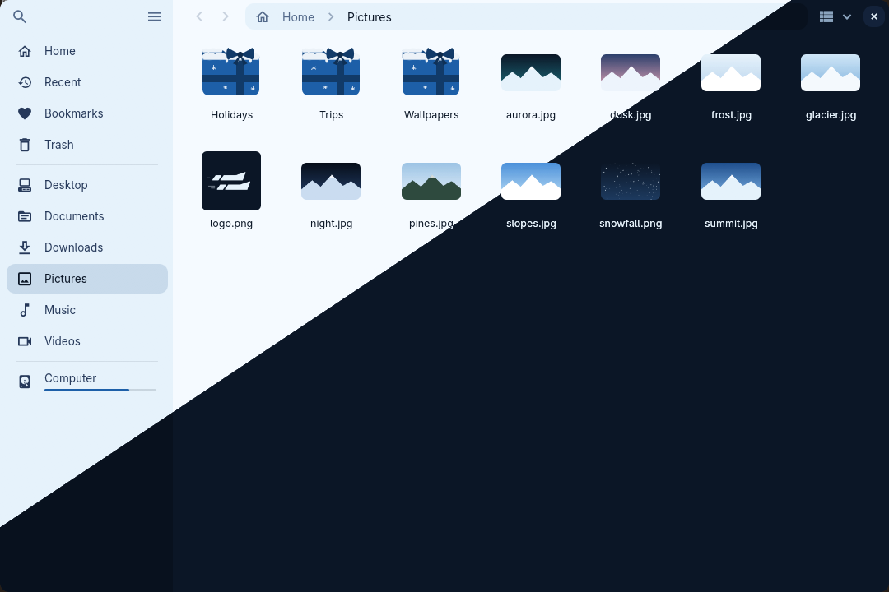

<p align="center">
  
</p>

<h1 align="center">Ski</h1>

A fast Rust file manager. Wayland and X11, list and grid views with thumbnails, tabs, vim keys, network shares and SSH servers, and a system file dialog.



## Install

Every [release](https://github.com/ilyamiro/Ski/releases/latest) has x86_64 packages:

```sh
sudo apt install ./ski_*_amd64.deb         # Debian, Ubuntu
sudo dnf install ./ski-*.x86_64.rpm        # Fedora, openSUSE
sudo tar -xzf ski-*-x86_64-linux.tar.gz -C /   # any other distribution
```

Docker, Cargo, Nix, the NixOS module and the home-manager module are covered in [Installation](https://github.com/ilyamiro/Ski/wiki/Installation).

## Documentation

The [wiki](https://github.com/ilyamiro/Ski/wiki) documents every feature:

- [Installation](https://github.com/ilyamiro/Ski/wiki/Installation) and [Desktop Integration](https://github.com/ilyamiro/Ski/wiki/Desktop-Integration) (default file manager, system file dialog)
- [Navigation](https://github.com/ilyamiro/Ski/wiki/Navigation), [File Operations](https://github.com/ilyamiro/Ski/wiki/File-Operations), [Search](https://github.com/ilyamiro/Ski/wiki/Search), [Servers](https://github.com/ilyamiro/Ski/wiki/Servers)
- [Plugins](https://github.com/ilyamiro/Ski/wiki/Plugins): Git, Checksums, Tags, Duplicate Finder, Compare Folders, Quick Look, Custom Actions
- [Settings](https://github.com/ilyamiro/Ski/wiki/Settings), [Keyboard Shortcuts](https://github.com/ilyamiro/Ski/wiki/Keyboard-Shortcuts), [Themes and Appearance](https://github.com/ilyamiro/Ski/wiki/Themes-and-Appearance)
- [Troubleshooting](https://github.com/ilyamiro/Ski/wiki/Troubleshooting)

Found a bug? Open an [issue](https://github.com/ilyamiro/Ski/issues) with your distribution and whether you use Wayland or X11.

## License

[MIT](LICENSE). The bundled fonts keep their own licenses: Adwaita Sans (SIL OFL) and Symbols Nerd Font Mono (MIT).
