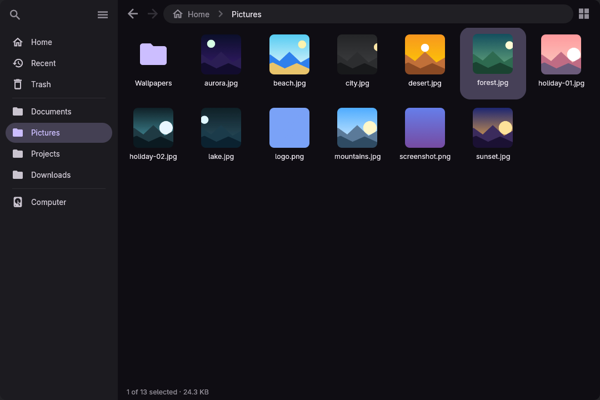
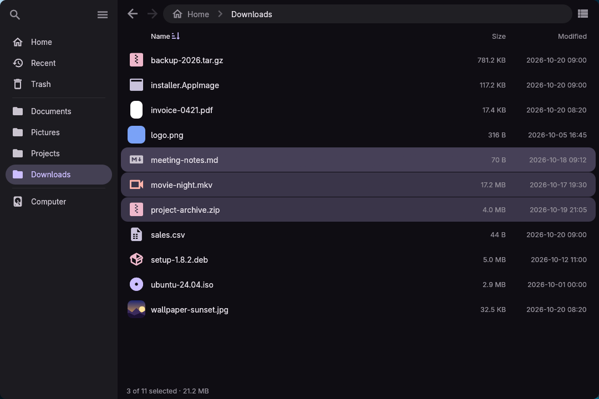
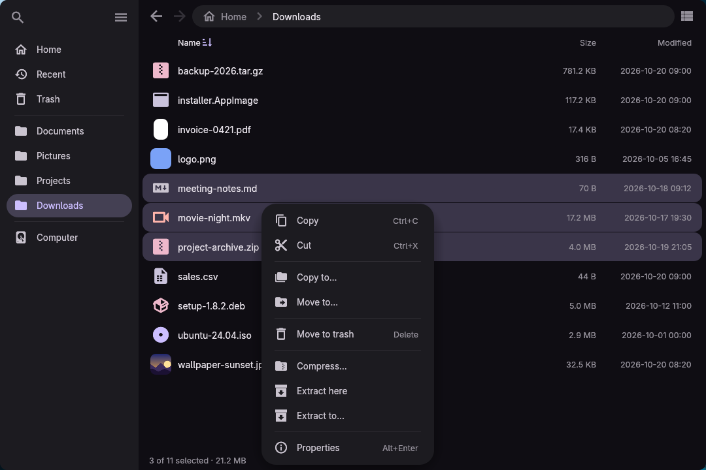
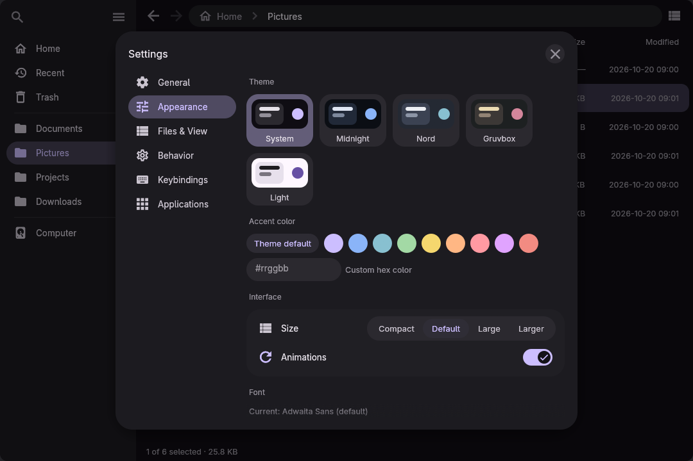
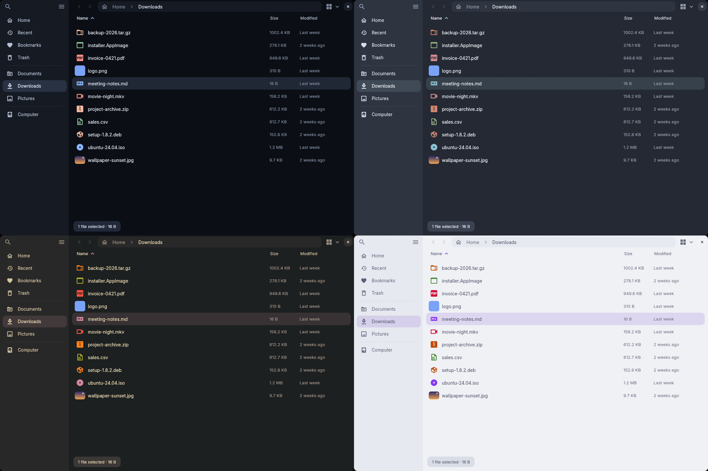

<p align="center">
  
</p>

<h1 align="center">Ski</h1>

A small, fast, keyboard-friendly file manager for Linux, written in Rust. Flat Material look, instant previews, vim keys.



## Install

### Docker or Podman

```sh
curl -fsSL https://raw.githubusercontent.com/ilyamiro/Ski/master/docker/ski-docker -o ski-docker
chmod +x ski-docker
./ski-docker [folder]
```

The script detects Wayland or X11 and mounts your home folder so you see your real files. Use `SKI_ENGINE=podman` for Podman. In the container, "Open with…" can't launch your host apps, so for everyday use install Ski natively.

To build the image yourself:

```sh
docker build -t ski .
SKI_IMAGE=ski ./docker/ski-docker
```

### Cargo

Needs Rust 1.85 or newer.

```sh
cargo install --git https://github.com/ilyamiro/Ski
```

Ski loads its graphics libraries at run time. If it fails to start, install them:

```sh
# Debian, Ubuntu
sudo apt install libwayland-client0 libxkbcommon0 libxkbcommon-x11-0 libx11-6 libxcursor1 libxi6 libxrandr2 libgl1 libegl1 xdg-utils
# Fedora
sudo dnf install libwayland-client libxkbcommon libxkbcommon-x11 libX11 libXcursor libXi libXrandr mesa-libGL mesa-libEGL xdg-utils
# Arch
sudo pacman -S wayland libxkbcommon libxkbcommon-x11 libx11 libxcursor libxi libxrandr libglvnd xdg-utils
```

### Nix

```sh
git clone https://github.com/ilyamiro/Ski && cd Ski
nix-shell --run 'cargo run --release'
```

To install it on NixOS, import the package in `configuration.nix`. It ships its own desktop entry and icon:

```nix
environment.systemPackages = [ (pkgs.callPackage /path/to/Ski { }) ];
```

### NixOS: default file manager and system file dialog

`nix/module.nix` installs Ski and makes it the default file manager and the system's open / save dialog:

```nix
{
  imports = [ /path/to/Ski/nix/module.nix ];
  programs.ski.enable = true;
  # programs.ski.defaultFileManager = false;  # keep your current file manager
  # programs.ski.filePicker = false;          # keep your current file dialog
}
```

It sets `inode/directory` to Ski, adds Ski as an xdg-desktop-portal backend for `org.freedesktop.impl.portal.FileChooser`, and sets `GTK_USE_PORTAL=1`. Log out and in after `nixos-rebuild switch`. Programs that use the portal then show Ski for "Open" and "Save as". Firefox also needs `widget.use-xdg-desktop-portal.file-picker = 1` (`programs.firefox.preferences` on NixOS); Chromium needs `--enable-features=UseXdgDesktopPortal` unless it picks it up itself. Programs with a dialog of their own don't use the portal and keep it.

### Application menu and default file manager

```sh
install -Dm644 assets/ski.desktop ~/.local/share/applications/ski.desktop
install -Dm644 assets/logo.svg ~/.local/share/icons/hicolor/scalable/apps/ski.svg
xdg-mime default ski.desktop inode/directory   # optional: open folders with Ski
```

### Other distributions: file dialog and file manager service

Ski can answer `org.freedesktop.FileManager1` (browsers' "Show in folder") and be the portal FileChooser. Install the files in `assets/` (`ski.portal` into `share/xdg-desktop-portal/portals/`, the two `.service` files into `share/dbus-1/services/` with `@out@` replaced by your prefix), then add this to `~/.config/xdg-desktop-portal/portals.conf`:

```ini
[preferred]
org.freedesktop.impl.portal.FileChooser=ski
```

`ski --portal` is the service itself; D-Bus starts it when needed. Each dialog is `ski --chooser --mode open|folder|save|save-files` in a window of its own, which prints the chosen `file://` URIs and exits with 0 (or 1 if cancelled).

## Usage

```sh
ski              # open the current folder
ski ~/Downloads  # open a specific folder
```

| To | Do this |
| --- | --- |
| Move around | Click, or use `j` `k` or the arrow keys and `Enter`. `Backspace` or `h` goes up. |
| Go to a path | `Ctrl+L`, type the path, `Enter` |
| Search | `/`, then type a name. `Esc` leaves the results. |
| Pin a folder or file to the sidebar | Select it and press `Ctrl+D` (with nothing selected: the open folder). Drag pinned rows to reorder. |
| Move or copy by dragging | Drag items onto a folder, sidebar place, breadcrumb or tab. Hold `Ctrl` to copy. |
| Open a folder in a tab | Middle-click it, or `Ctrl+T` for a new tab |
| Eject a drive | Hover it in the sidebar and click the eject button |
| Switch list and grid | `Ctrl+1` and `Ctrl+2` |
| Settings | `Ctrl+,` |
| See all shortcuts | `?` |

Right-click anything for a menu that shows the shortcut of each action.





## Keyboard shortcuts

| Keys | Action |
| --- | --- |
| `j` / `k`, arrows | Move selection |
| `Enter` / `l` | Open |
| `Backspace` / `h` / `Alt+↑` | Parent folder |
| `Alt+←` / `Alt+→` | Back / forward (also the mouse buttons) |
| `Home` / `g`, `End` / `Shift+G` | First / last item |
| `Alt+Home` | Home folder |
| `Shift`+arrows, `Shift`/`Ctrl`+click | Select several |
| `Ctrl+A` | Select all |
| `Ctrl+C` / `Ctrl+X` / `Ctrl+V` | Copy / cut / paste |
| `F2` | Rename (with several files selected: by template, or find and replace) |
| `Delete` / `Shift+Delete` | Move to trash / delete permanently |
| `Ctrl+Shift+N` / `Ctrl+Alt+N` | New folder / new file |
| `y` | Copy path |
| `Alt+Enter` | Properties |
| `Ctrl+H` | Show or hide hidden files |
| `F5` | Refresh |
| `Ctrl+N` | New window |
| `Ctrl+T` / `Ctrl+W` | New tab / close tab (closes the window on the last tab) |
| `Ctrl+Tab` / `Ctrl+Shift+Tab`, `Ctrl+PageDown` / `Ctrl+PageUp` | Next / previous tab |
| `Ctrl+Z` | Undo the last file operation |
| `Ctrl+Shift+Z` / `Ctrl+Y` | Redo |
| `Ctrl+Shift+D` | Duplicate |
| `Ctrl+Shift+M` | Create link |
| `F4` | Open the folder in a terminal |
| `Ctrl+S` | Select items matching a pattern such as `*.png` |
| `Ctrl+Shift+I` / `Ctrl+Shift+A` | Invert selection / deselect all |
| `Ctrl+J` | Show running file operations |
| `Menu` / `Shift+F10` | Open the context menu for the selection |
| `Esc` | Close a dialog, clear the search, then deselect |
| `Ctrl+Q` | Quit |

All of these can be changed in Settings, under Keybindings.

### Menus and dialogs

Settings, the context menu, the operations list and every dialog work without a mouse. A ring shows where the focus is.

| Keys | Action |
| --- | --- |
| `Tab` / `Shift+Tab` | Next / previous control (stays inside the open dialog or menu) |
| Arrows | Move to the control in that direction. In a menu, `Home` / `End` jump to the first / last entry. |
| `Left` / `Right` on a choice such as Sort by | Pick the previous / next option |
| `Enter` / `Space` | Activate the focused control |
| `Up` / `Down` in Settings' category list | Switch category; `Right` or `Tab` goes into its settings, `Left` comes back |
| `Ctrl+PageUp` / `Ctrl+PageDown` | Previous / next Settings category from anywhere |
| `Esc` | Close the menu or dialog |

## Settings

`Ctrl+,` opens Settings: language, theme and accent color, interface size, font, default view and sorting, list columns, grid size, startup folder, single-click open, vim keys, terminal command, templates folder, and default apps.



The default theme follows your [Serpantinum](https://github.com/ilyamiro) colors if you use them. Midnight, Nord, Gruvbox and Light are built in.



Settings are stored in `~/.config/ski/settings.json`, and the trash in `~/.local/share/Trash`.

## Archives

`.zip` and `.tar.gz` work out of the box. Other formats use system tools and only appear when those are installed:

| Format | Needs |
| --- | --- |
| `.tar.xz` | `tar`, `xz` |
| `.tar.bz2` | `tar`, `bzip2` |
| `.tar.zst` | `tar`, `zstd` |
| `.7z`, and extracting `.rar`, `.iso`, `.deb`, `.rpm` | `7z` |

On Debian or Ubuntu: `sudo apt install xz-utils bzip2 zstd p7zip-full`.

## Troubleshooting

- **No window, or errors about Wayland or libxkbcommon:** install the libraries listed under Cargo above. On Nix, start Ski from `nix-shell`.
- **Blank window in a VM:** try `LIBGL_ALWAYS_SOFTWARE=1 ski`.
- **Want X11 on a Wayland session:** `env -u WAYLAND_DISPLAY ski`.
- **Interface too small or large:** Settings → Appearance → Size.
- **Missing `.7z` or `.tar.xz` when compressing:** install the tools listed under Archives.

Found a bug? Open an [issue](https://github.com/ilyamiro/Ski/issues) with your distribution and whether you use Wayland or X11.

## License

[MIT](LICENSE). The bundled fonts keep their own licenses: Adwaita Sans (SIL OFL) and Symbols Nerd Font Mono (MIT).
